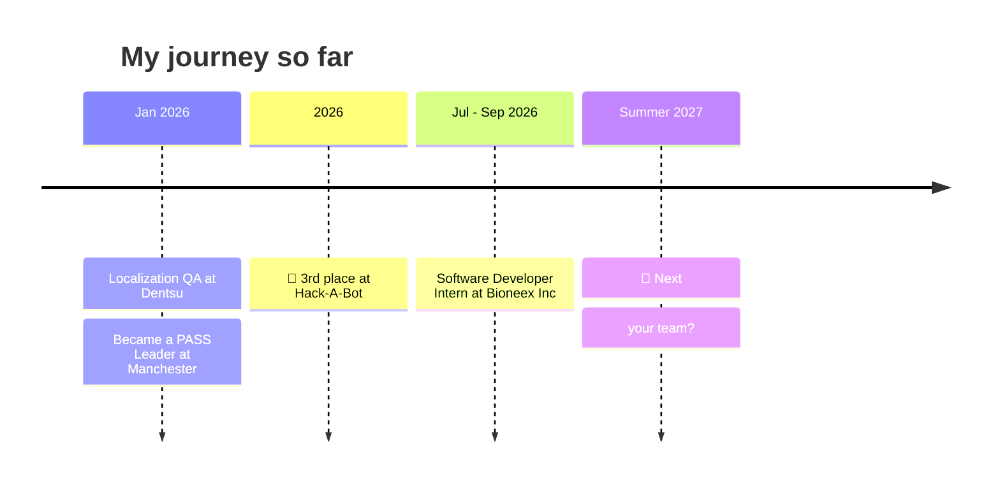

 

 

  

 

## 🧭 &nbsp;About me

> *"I practise every day, and I learn by building."*

I'm a second-year Computer Science student at the **University of Manchester**. My favourite projects sit where software meets the physical world and the machine itself: a **CPU simulator** in Python, a **wireless Arduino robot**, a **university recommendation engine** and a **secure finance tracker**. I'm aiming for a career in software engineering.

<table>
  <tr>
    <td width="50%" valign="top">

**💼 Recently**
Software Developer Intern at **Bioneex Inc** *(Jul – Sep 2026)*

**🏆 Award**
🥉 3rd place, **Hack-A-Bot 2026**, University of Manchester robotics hackathon

**🤝 Also**
**PASS Leader**, mentoring first-year Computer Science students

  </td>
    <td width="50%" valign="top">

**🎯 Looking for**
Summer 2027 software engineering internships & insight programmes

**🌱 Learning**
Cloud engineering · Computer architecture · Data science

**💬 Ask me about**
Python · RISC-V · Arduino & robotics · Full-stack web · Hackathons

  </td>
  </tr>
</table>

 

## 🚀 &nbsp;Featured projects

<table>
  <tr>
    <td width="50%" valign="top">
      <h3>🕵️ <a href="https://github.com/harutyunmajaryan/MugshotAI">MugshotAI</a></h3>
      
Witness-description search tool that scans an entire mugshot database and returns every record whose facial appearance matches the description. Python handles description processing and match ranking; SQL handles storing and querying the records.

      
    </td>
    <td width="50%" valign="top">
      <h3>🎓 <a href="https://github.com/harutyunmajaryan/FindYourUni_Website">FindYourUni</a></h3>
      
Full-stack university recommendation engine built in a <b>team of 4</b>. Matches UK applicants to <b>100+ institutions</b> using multi-criteria filtering (JavaScript) and a <b>KNN algorithm</b> (Python) across 6 metrics.

      
    </td>
  </tr>
  <tr>
    <td width="50%" valign="top">
      <h3>🧠 <a href="https://github.com/harutyunmajaryan/RISC-V-Simulator">RISC-V Simulator</a></h3>
      
Custom CPU simulator that executes <b>25 core RISC-V instructions</b>, with a GUI tracking all <b>32 registers</b>, the program counter and memory in real time, plus a built-in ISA reference.

       
    </td>
    <td width="50%" valign="top">
      <h3>🤖 <a href="https://github.com/harutyunmajaryan/Hack-A-Robot-Solo-Project">Hack-A-Robot</a> &nbsp;🥉</h3>
      
Award-winning <b>wireless robot</b> with a custom multi-axis gripper. A Python control pipeline sends low-latency commands to Arduino firmware. Designed in CAD, built and wired by hand.

      
    </td>
  </tr>
  <tr>
    <td width="50%" valign="top">
      <h3>💰 <a href="https://github.com/harutyunmajaryan/Finance-Tracker-App">Finance Tracker</a></h3>
      
Full-stack finance dashboard to log, categorise and visualise income, expenses and transfers. Features <b>atomic balance updates</b> and a hardened schema: parameterised queries, access control and encryption.

      
    </td>
    <td width="50%" valign="top">
      <h3>☁️ Labs &amp; coursework</h3>
      

        <a href="https://github.com/harutyunmajaryan/Google-Cloud-Engineering"><b>Google-Cloud-Engineering</b></a>: hands-on Google Cloud work.  
        <a href="https://github.com/harutyunmajaryan/Data-Science"><b>Data-Science</b></a>: data science laboratory work.
      

      
    </td>
  </tr>
</table>

 

## 🛠️ &nbsp;Tech stack

**Languages**

**Tools & Platforms**

**Concepts**

`Full-stack development` &nbsp; `OOP` &nbsp; `Algorithm design` &nbsp; `Computer architecture`
`Operating systems` &nbsp; `Distributed systems` &nbsp; `Machine learning` &nbsp; `Databases`

 

## 💼 &nbsp;Experience

<table>
  <tr>
    <td width="170" valign="top"><code>Jul – Sep 2026</code></td>
    <td>
      <b>Software Developer (Intern)</b> · <i>Bioneex Inc, Yerevan</i> 
      Coding, testing and debugging in a live production environment for a bioscience company that lists drug candidates for licensing, acquisition and funding.
    </td>
  </tr>
  <tr>
    <td valign="top"><code>Jan 2026</code></td>
    <td>
      <b>Localization QA / Linguistic Tester</b> · <i>Dentsu (Contract)</i> 
      Validated Armenian-language content for NEXT, resolving <b>50+ localisation issues</b> with <b>zero post-launch corrections</b>.
    </td>
  </tr>
  <tr>
    <td valign="top"><code>Jan 2026 – Present</code></td>
    <td>
      <b>PASS Leader</b> · <i>University of Manchester</i> 
      Run Peer-Assisted Study Sessions for first-year Computer Science students.
    </td>
  </tr>
</table>

 

## 🏆 &nbsp;Awards

| 🥇 | 🥈 | 🥉 | 🎖️ |
| :---: | :---: | :---: | :---: |
| **1st Place** Mathematics Project *Golden Ratio* | **Silver Medal** WSMC Math & Science *Olympiad* | **3rd Place** Hack-A-Bot 2026 *UoM robotics hackathon* | **Distinction** Physics Project *Electromagnetic Waves* |

 

## 📊 &nbsp;GitHub stats & activity

  

  

 

I'd love to chat, so feel free to reach out. 💬

  

⭐ <i>If something here looks interesting, drop a star on the repo!</i>

