<h1>Hi, I'm Harutyun! 👋 Welcome to my profile :)</h1>

  

 

  

 

## 🚀 Featured Projects

<table>
  <tr>
    <td width="50%" valign="top">
      <h3>🕵️ <a href="https://github.com/harutyunmajaryan/MugshotAI">MugshotAI</a></h3>
      
Witness-description search tool that scans an entire mugshot database and returns every record whose facial appearance matches the description. Python handles description processing and match ranking; SQL handles storing and querying the records.

       
    </td>
    <td width="50%" valign="top">
      <h3>🎓 <a href="https://github.com/harutyunmajaryan/FindYourUni_Website">FindYourUni</a></h3>
      
Full-stack university recommendation engine built in a <b>team of 4</b>. Matches UK applicants to <b>100+ institutions</b> using multi-criteria filtering (JavaScript) and a <b>KNN algorithm</b> (Python) across 6 metrics.

         
    </td>
  </tr>
  <tr>
    <td width="50%" valign="top">
      <h3>🧠 <a href="https://github.com/harutyunmajaryan/RISC-V-Simulator">RISC-V Simulator</a></h3>
      
Custom CPU simulator that executes <b>25 core RISC-V instructions</b>, with a GUI tracking all <b>32 registers</b>, the program counter and memory in real time, plus a built-in ISA reference.

       
    </td>
    <td width="50%" valign="top">
      <h3>🤖 <a href="https://github.com/harutyunmajaryan/Hack-A-Robot-Solo-Project">Hack-A-Robot</a> &nbsp;🥉</h3>
      
Award-winning <b>wireless robot</b> with a custom multi-axis gripper. A Python control pipeline sends low-latency commands to Arduino firmware. Designed in CAD, built and wired by hand.

        
    </td>
  </tr>
  <tr>
    <td width="50%" valign="top">
      <h3>💰 <a href="https://github.com/harutyunmajaryan/Finance-Tracker-App">Finance Tracker</a></h3>
      
Full-stack finance dashboard to log, categorise and visualise income, expenses and transfers. Features <b>atomic balance updates</b> and a hardened schema: parameterised queries, access control and encryption.

          
    </td>
    <td width="50%" valign="top">
      <h3>☁️ Labs &amp; Coursework</h3>
      

        <a href="https://github.com/harutyunmajaryan/Google-Cloud-Engineering"><b>Google-Cloud-Engineering</b></a>: hands-on Google Cloud work.  
        <a href="https://github.com/harutyunmajaryan/Data-Science"><b>Data-Science</b></a>: data science laboratory work.
      

       
    </td>
  </tr>
</table>

 

## 💼 Experience

- **Software Developer (Intern)** | *Bioneex Inc, Yerevan* `Jul – Sep 2026`
  Coding, testing and debugging in a live production environment for a bioscience company that lists drug candidates for licensing, acquisition and funding.
- **Localization QA / Linguistic Tester** | *Dentsu (Contract)* `Jan 2026`
  Validated Armenian-language content for NEXT, resolving **50+ localisation issues** with **zero post-launch corrections**.
- **PASS Leader** | *University of Manchester* `Jan 2026 – Present`
  Run Peer-Assisted Study Sessions for first-year Computer Science students.

 

## 🏆 Awards

- 🥉 **3rd Place**, Hack-A-Bot 2026, University of Manchester robotics hackathon
- 🥇 **1st Place**, Mathematics Project (Golden Ratio)
- 🏅 **Silver Medal**, WSMC Math & Science Olympiad
- 🎖️ **Distinction**, Physics Project on Electromagnetic Waves

 

## 📊 GitHub Stats

  
  

<picture>
  <source media="(prefers-color-scheme: dark)" srcset="https://raw.githubusercontent.com/harutyunmajaryan/harutyunmajaryan/output/contributions-dark.svg" />
  <source media="(prefers-color-scheme: light)" srcset="https://raw.githubusercontent.com/harutyunmajaryan/harutyunmajaryan/output/contributions.svg" />
  
</picture>

 

## 🛠️ My Stack

### Languages

### Libraries & Frameworks

### Databases & Tools

### Concepts

 

## 🔗 Connect with Me

 

🤝 *I love connecting with new people, so if you want to say hi, I'd be happy to get to know you! :)*

 

⭐ <i>If something here looks interesting, drop a star on the repo!</i>
